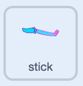
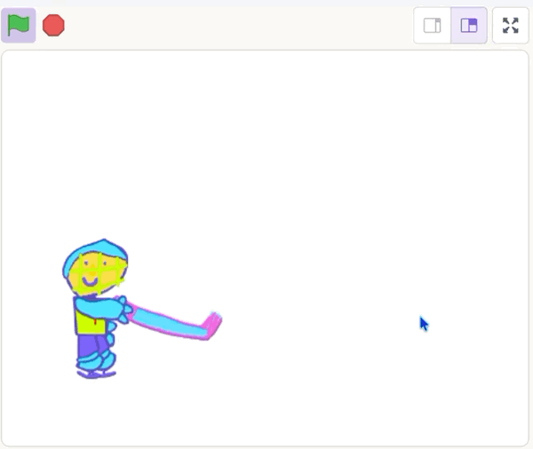

## Move the stick

Use the mouse to move the hockey stick.

## Step 1
Click on the stick sprite, it has some blocks to get you started. 

{:width="150px"}


## Step 2

Add a `broadcast`{:class="block3events"} block to the bottom of the green flag script.

Click the drop-down and choose `reset`{:class="block3events"}.

A `broadcast`{:class="block3events"} block sends a message that other scripts listen out for.

```blocks3
when green flag clicked
go to x: (-168) y: (-51)
set drag mode [not draggable v]
+broadcast (reset v)
```

## Step 3

Add a `when I receive`{:class="block3events"} block set to `reset`.

Then add a `repeat until`{:class="block3control"} loop, with a `point towards`{:class="block3motion"} block inside.


```blocks3
when I receive (reset v)
+repeat until < >
point towards (mouse-pointer v)
end
```

**Test:** click the green button and check that the stick moves.

## Step 4

Add a `mouse down`{:class="block3sensing"} block to stop the movement when clicked.

```blocks3
when I receive (reset v)
repeat until <mouse down?>
point towards (mouse-pointer v)
end
```


## Now run your code

Click the **Green Flag**. Check that the stick moves with the mouse pointer and stops when clicked.

{:width="450px"}
