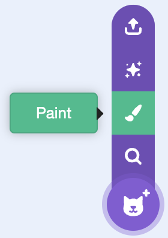
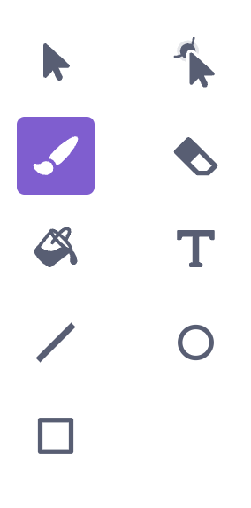
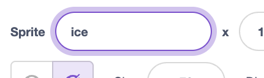
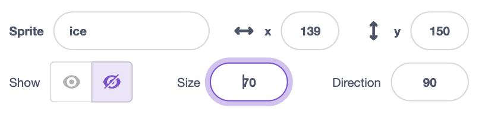
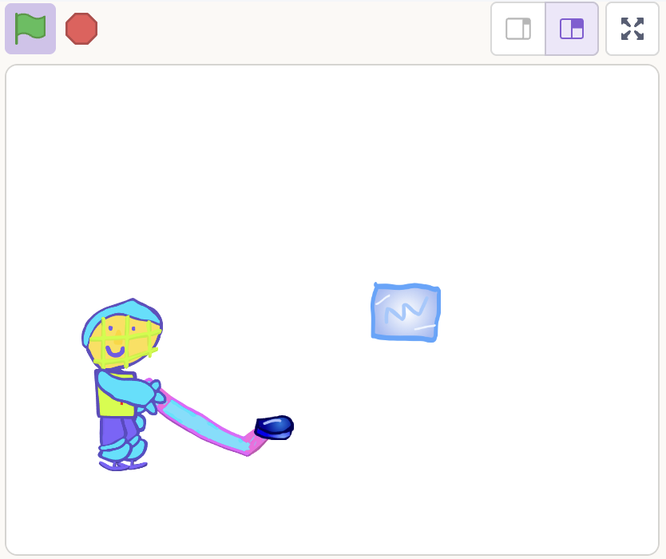

## Create the ice

Make an ice cube for the puck to pop.

## Step 1

Hover over the **Choose a Sprite** button and click **Paint**.

{:width="250px"}

## Step 2

Draw an **ice** cube and position it in the centre of paint window.

{:width="150px"}

## Step 3

Name the sprite **ice** in the **Sprite** name box.

{:width="250px"}

## Step 4

Change the number in the **Size** box until the **ice** cube is bigger than the **puck**.

{:width="250px"}

{:width="450px"}
