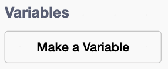

## Move the ice

Make the ice move towards the player.

## Step 1

Click on the **ice sprite**.

{:width="150px"}

## Step 2

Make a variable called `ice speed`{:class="block3variables"} for all sprites.

{:width="250px"}

## Step 3

Add a `set ice speed to`{:class="block3variables"} block set to `3` at the top of the green flag script.

```blocks3
when green flag clicked
+set [ice speed v] to (3)
go to x: (139) y: (-120)
repeat (6)
create clone of (myself v)
change y by (45)
end
```

## Step 4

Add a second `when I start as a clone`{:class="block3control"} block that moves the ice left after `ice speed`{:class="block3variables"} seconds.

```blocks3
when I start as a clone
forever
wait (ice speed) seconds
change x by (-50)
end
```

## Now run your code

Click the **Green Flag**.
Check that the ice steps to the left every three seconds.

{:width="450px"}
