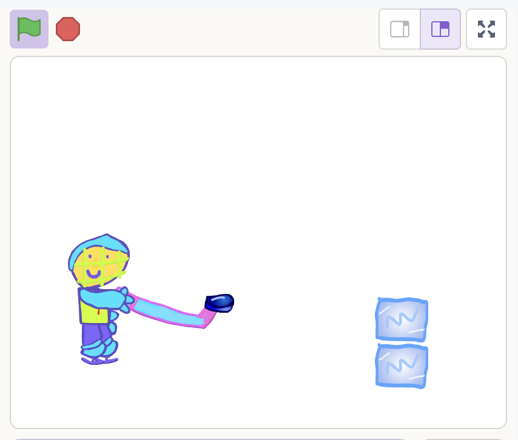

## Clone the ice

Make a clone of the ice cube.

{:width="80px"}

## Step 1

Click on the **ice sprite**.

## Step 2

In the **Code** tab, add a green flag and set its `x` and `y` starting positions.

```blocks3
when green flag clicked
go to x: (139) y: (-120)
```

## Step 3

Add a `create clone`{:class="block3control"} block and then `change y`{:class="block3motion"} by `45`.

```blocks3
when green flag clicked
go to x: (139) y: (-120)
+create clone of (myself v)
+change y by (45)
```

## Now run your code

Click the **Green Flag** and check that a second **ice** cube appears above the first.

> [!TIP]
>
> You may need to change the number to suit your sprite.

{:width="450px"}
