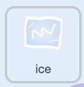

## Make new lines of ice

Make a new column of ice every few seconds.



You're still working on the **ice sprite**.

## Step 1

Add a `forever`{:class="block3control"} loop to the end of the green flag script.

Add a `wait`{:class="block3control"} block with `ice speed`{:class="block3variables"} inside it.

```blocks3
when green flag clicked
set [ice speed v] to (3)
go to x: (139) y: (-120)
hide
repeat (6)
create clone of (myself v)
change y by (45)
end
+forever
wait (ice speed) seconds
end
```

## Step 2

Duplicate the `go to x: () y: ()`{:class="block3motion"} block and the `repeat`{:class="block3control"} loop.
Put the copies inside the `forever`{:class="block3control"} loop.

Keeping the first set of blocks means a line of ice appears straight away, instead of waiting `ice speed`{:class="block3variables"} seconds for the first one.

{:width="450px"}

## Now run your code

Click the **Green Flag**.
Check that a new column of ice arrives every few seconds.

Change the number in the `set ice speed to`{:class="block3variables"} block to speed the ice up or slow it down.

{:width="450px"}
