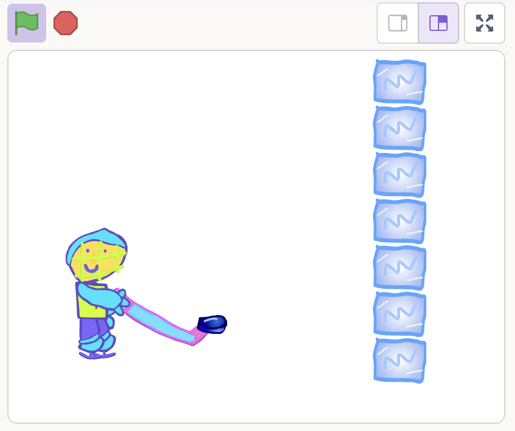

## Repeat clones

Repeat six ice cubes in a line.

{:width="80px"}

You're still working on the **ice sprite**.

## Step 1

Put the two blocks inside a `repeat`{:class="block3control"} loop set to `6`.

```blocks3
when green flag clicked
go to x: (139) y: (-120)
+repeat (6)
create clone of (myself v)
change y by (45)
end
```

> [!TIP]
>
> Experiment with the number in the `repeat`{:class="block3control"} loop to make a longer or shorter line of **ice**.

## Now run your code

Click the **Green Flag**. Check that a line of seven **ice** cubes appears.

{:width="450px"}
