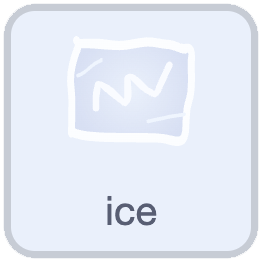
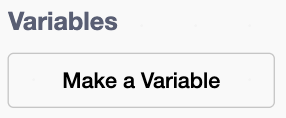
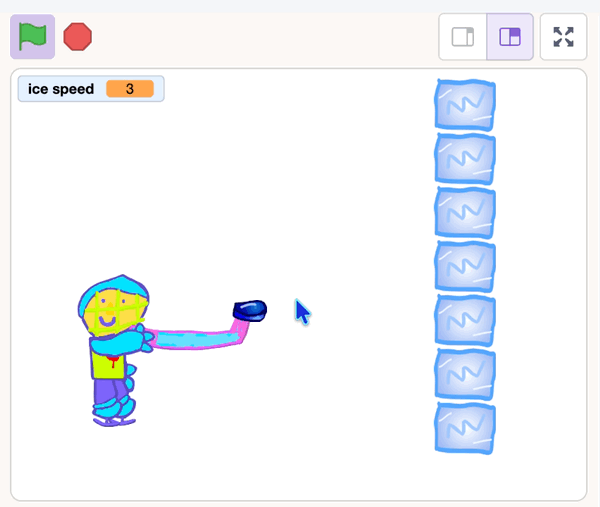

## Move the ice

The ice moves across the stage, getting closer to the player.

{:width="150px"}

You're still working on the **ice sprite**.

## Step 1

First make a speed for the ice.
Make a variable called `ice speed`{:class="block3variables"} for all sprites.

{:width="250px"}

## Step 2

Set `ice speed`{:class="block3variables"} to `3`. This is how often more ice will appear.

```blocks3
when green flag clicked
+set [ice speed v] to (3)
go to x: (139) y: (-120)
repeat (6)
create clone of (myself v)
change y by (45)
end
```

## Step 3

Add a `when I start as a clone`{:class="block3control"} block with a `forever`{:class="block3control"} loop.

```blocks3
when I start as a clone
+forever
end
```

## Step 4

Move the ice left after `ice speed`{:class="block3variables"} seconds.

```blocks3
when I start as a clone
forever
+wait (ice speed) seconds
+change x by (-50)
end
```

## Now run your code

Click the **Green Flag**. Check that the ice moves towards the player.

> [!TIP]
>
> Change the `ice speed`{:class="block3variables"} number to make the ice move faster or slower.

{:width="450px"}
