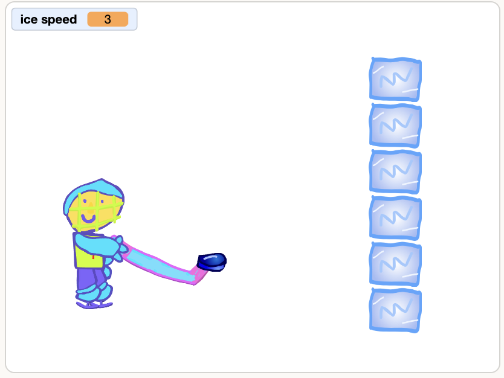

## Hide the original

The original ice cube stays still. Hide it so only the clones show.

{:width="80px"}

You're still working on the **ice sprite**.

## Step 1

Add a `hide`{:class="block3looks"} block under the green flag.

```blocks3
when green flag clicked
+hide
set [ice speed v] to (3)
go to x: (139) y: (-120)
repeat (6)
create clone of (myself v)
change y by (45)
end
```

## Step 2

Add a `show`{:class="block3looks"} block under `when I start as a clone`{:class="block3control"}.

Each clone shows itself as it is made.

```blocks3
when I start as a clone
+show
forever
wait (ice speed) seconds
change x by (-50)
end
```

## Now run your code

Click the **Green Flag**. Check that six **ice** cubes move across the stage, with nothing left behind.

{:width="450px"}
