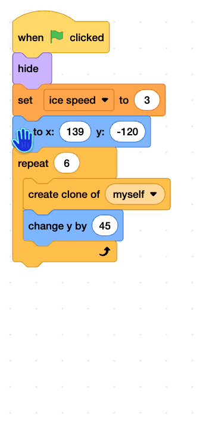
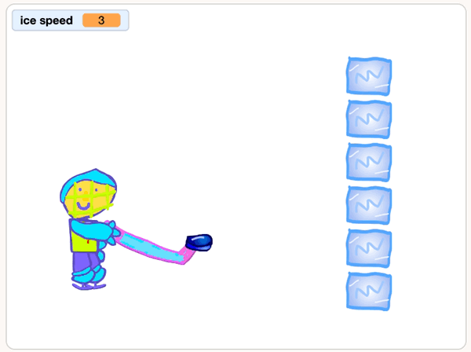

## Make new lines of ice

Make a new column of ice every few seconds.

{:width="150px"}

You're still working on the **ice sprite**.

## Step 1

Right click on the `go to x: y:`{:class="block3motion"} to duplicate.

{:width="450px"}

## Step 2

Put the duplicated blocks inside a `forever`{:class="block3control"} loop.

```blocks3
when green flag clicked
hide
set [ice speed v] to (3)
go to x: (139) y: (-120)
repeat (6)
create clone of (myself v)
change y by (45)
end
+forever
go to x: (139) y: (-120)
repeat (6)
create clone of (myself v)
change y by (45)
end
+end
```

## Step 3

Add a `wait`{:class="block3control"} block with `ice speed`{:class="block3variables"} to the top of the `forever`{:class="block3control"} loop.

```blocks3
when green flag clicked
hide
set [ice speed v] to (3)
go to x: (139) y: (-120)
repeat (6)
create clone of (myself v)
change y by (45)
end
forever
+wait (ice speed) seconds
go to x: (139) y: (-120)
repeat (6)
create clone of (myself v)
change y by (45)
end
end
```

## Now run your code

Click the **Green Flag**. Check that a new column of ice arrives every few seconds.

{:width="450px"}
