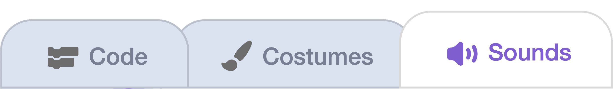

## Add a sound

Play a sound when the ice bursts.

{:width="150px"}

You're still working on the **ice sprite**.

## Step 1

Open the **Sounds** tab.

{:width="450px"}

## Step 2

Click **Choose a Sound** and pick one that will work for bursting ice from the library.

## Step 3

Back in the **Code** tab, add a `start sound`{:class="block3sound"} block above `delete this clone`{:class="block3control"} and choose your sound.

```blocks3
when I start as a clone
show
wait until <touching (puck v)?>
+start sound (pop v)
delete this clone
```

## Now run your code

Click the **Green Flag** and shoot the puck at the ice.
Check that your sound plays when the puck hits the ice.

{:width="450px"}
