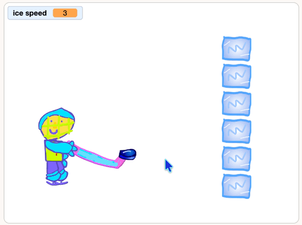

## Hit the ice

Make an ice cube disappear when the puck hits it.

{:width="80px"}

You're still working on the **ice sprite**.

## Step 1

First check that the **ice** is touching the **puck**.

Start a second `when I start as a clone`{:class="block3control"} and add a `wait until`{:class="block3control"} block, with `touching`{:class="block3sensing"} set to **puck** inside it.

```blocks3
+when I start as a clone
+wait until <touching (puck v)?>
```

## Step 2

Make the **ice** disappear with a `delete this clone`{:class="block3control"}.

```blocks3
when I start as a clone
wait until <touching (puck v)?>
+delete this clone
```

## Now run your code

Click the **Green Flag** and shoot the **puck** at the **ice**. Check that the **ice** cube disappears when the **puck** hits it.

{:width="450px"}
