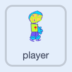

## Game over

End the game when the ice reaches the player.

## Step 1

Click on the **player sprite**.



## Step 2

Add a new script with an empty `wait until`{:class="block3control"} block.

```blocks3
when green flag clicked
wait until < >
```

## Step 3

Add a `touching`{:class="block3sensing"} block set to **ice**.

```blocks3
when green flag clicked
wait until <touching (ice v)?>
```

## Step 4

Add a `stop other scripts in sprite`{:class="block3control"} block.

```blocks3
when green flag clicked
wait until <touching (ice v)?>
+stop [other scripts in sprite v]
```

## Step 5

Add a `wait`{:class="block3control"} block set to `0.1` seconds and a `switch costume to`{:class="block3looks"} block set to `costume 3`{:class="block3looks"}.

```blocks3
stop [other scripts in sprite v]
+wait (0.1) seconds
+switch costume to (costume 3 v)
```

## Step 6

Add a `play sound until done`{:class="block3sound"} block set to `Alien Creak2`{:class="block3sound"}.

```blocks3
wait (0.1) seconds
switch costume to (costume 3 v)
+play sound (Alien Creak2 v) until done
```

## Step 7

Add a `stop all`{:class="block3control"} block.

```blocks3
switch costume to (costume 3 v)
play sound (Alien Creak2 v) until done
+stop [all v]
```

## Now run your code

Click the **Green Flag** and let the ice reach the player.
Check that the player changes costume, a sound plays, and the game stops.

{:width="450px"}
