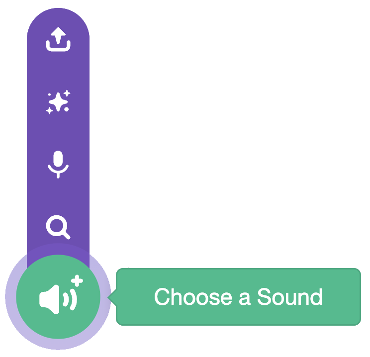

## Add a sound

Play a sound when the ice bursts.

{:width="150px"}

You're still working on the **ice sprite**.

## Step 1

Open the **Sounds** tab.

{:width="450px"}

## Step 2

Click **Choose a Sound** and pick one that will work for bursting ice from the library.

{:width="250px"}

## Step 3

In the **Code** tab, add a `start sound`{:class="block3sound"} block and choose your sound.

Then add a `wait`{:class="block3control"} block set to `0.05` seconds.

```blocks3
when I start as a clone
wait until <touching (puck v)?>
+start sound (pop v)
+wait (0.05) seconds
delete this clone
```

## Now run your code

Click the **Green Flag** and shoot the puck at the ice. Check that your sound plays when the puck hits the ice.
