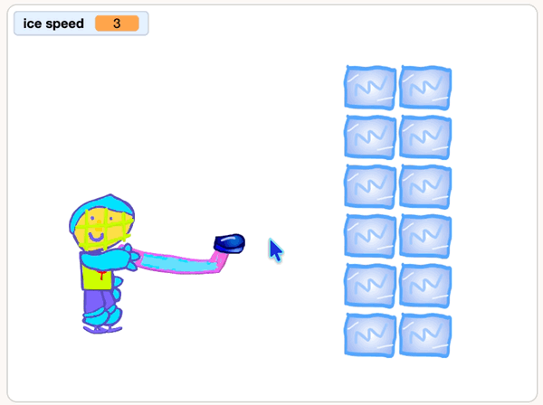

## Burst effect

Give the ice a burst as it disappears.

{:width="150px"}

You're still working on the **ice sprite**.

## Step 1

Add a `change effect by`{:class="block3looks"} block set to `fisheye` and `200`.

```blocks3
when I start as a clone
wait until <touching (puck v)?>
start sound (pop v)
+change [fisheye v] effect by (200)
wait (0.05) seconds
delete this clone
```

## Step 2

Change the size — you can make it bigger by changing the number.

```blocks3
wait until <touching (puck v)?>
start sound (pop v)
change [fisheye v] effect by (200)
+change size by (20)
wait (0.05) seconds
delete this clone
```

## Now run your code

Click the **Green Flag** and shoot the puck at the ice. Check that you are happy with the burst effect.

{:width="450px"}
