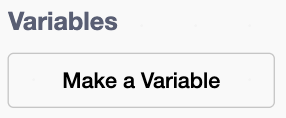

## Keep score

Count the ice cubes that get hit.

{:width="150px"}

You're still working on the **ice sprite**.

## Step 1

Make a variable called `score`{:class="block3variables"} for all sprites.

{:width="250px"}

## Step 2

Add a `set score`{:class="block3variables"} to `0` block at the top of the green flag script.

```blocks3
when green flag clicked
hide
+set [score v] to (0)
set [ice speed v] to (3)
go to x: (139) y: (-120)
```

## Step 3

`Change score`{:class="block3variables"} by `1` when the ice touches the puck.

```blocks3
when I start as a clone
wait until <touching (puck v)?>
+change [score v] by (1)
start sound (pop v)
change [fisheye v] effect by (200)
change size by (20)
wait (0.05) seconds
delete this clone
```

## Now run your code

Click the **Green Flag** and shoot the puck at the ice. Check that the score goes up by one for every ice cube hit.
