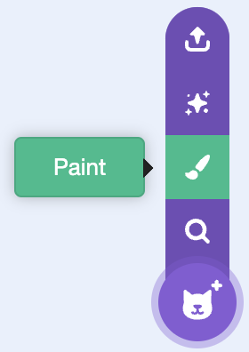
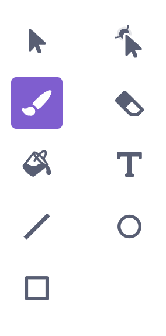
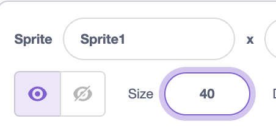
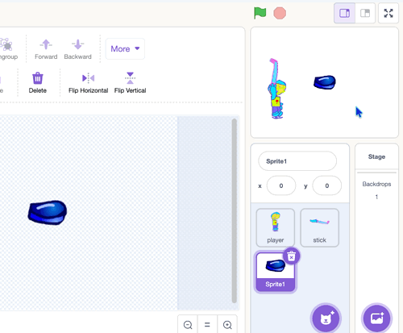
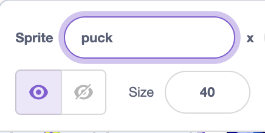
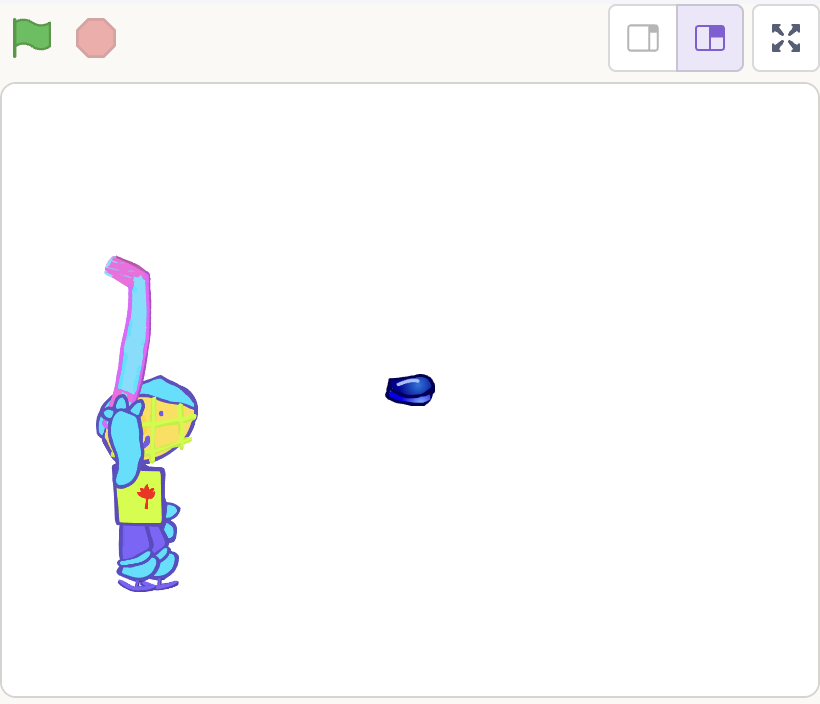

## Create a puck

Draw a hockey puck with the paint tools.

## Step 1

Hover over the **Choose a Sprite** button and click **Paint**.

{:width="250px"}

## Step 2

Use the **paint tools** to draw a puck.

{:width="150px"}

## Step 3

Adjust the number in the **Size** box until the puck is the size you want.

{:width="250px"}

> [!TIP]
>
> You can see more of the sprite menu by changing the view.

{:width="450px"}

## Step 4

Name the sprite **puck** into the **Sprite** name box.

{:width="250px"}

{:width="450px"}
