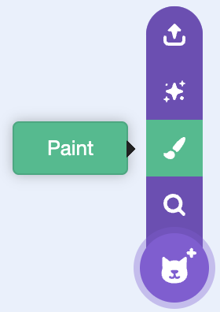
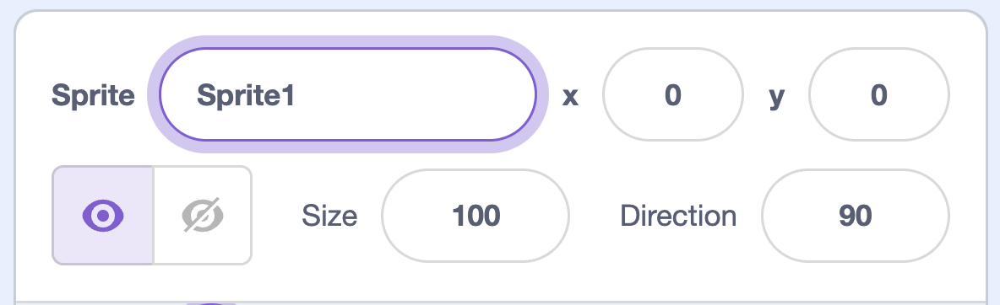

## Create a puck

Make a puck to shoot.

## Step 1

Hover over the **Choose a Sprite** button and click **Paint**.

{:width="250px"}

## Step 2

Draw a puck and resize so that it fits onto the stick

## Step 3

Name the sprite `puck` into the **Sprite** name box.

{:width="250px"}

{:width="450px"}
