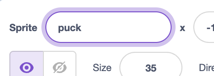
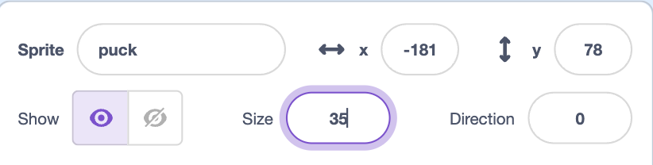

## Create a puck

Draw a hockey puck with the paint tools.

## Step 1

Hover over the **Choose a Sprite** button and click **Paint**.

{:width="250px"}

## Step 2

Use the paint tools to draw a puck.

## Step 3

Name the sprite **puck** into the **Sprite** name box.

{:width="250px"}

## Step 4

Change the number in the **Size** box until the puck is small enough to sit on the blade of the stick.

{:width="250px"}

{:width="450px"}
