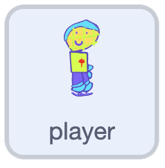
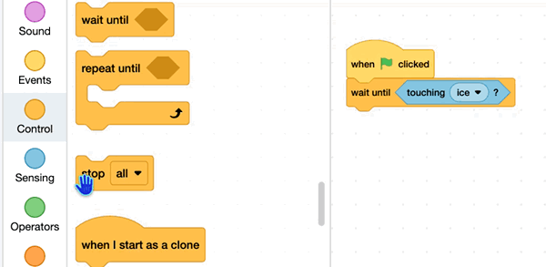

## Game over

End the game when the ice reaches the player.

## Step 1

Click on the **player sprite**.

{:width="80px"}

## Step 2

Add a new green flag block that `waits until`{:class="block3control"} it is `touching`{:class="block3sensing"} the **ice**.

```blocks3
+when green flag clicked
+wait until <touching (ice v)?>
```

## Step 3

Add a `stop other scripts in sprite`{:class="block3control"} block.

```blocks3
when green flag clicked
wait until <touching (ice v)?>
+stop [other scripts in sprite v]
```

> [!TIP]
>
> The `stop other scripts`{:class="block3control"} block can be found in the drop-down of `stop all`{:class="block3control"}.
>
> {:width="450px"}

## Step 4

Add a `stop all`{:class="block3control"} block.

```blocks3
when green flag clicked
wait until <touching (ice v)?>
stop [other scripts in sprite v]
+stop [all v]
```

## Now run your code

Click the **Green Flag** and let the **ice** reach the **player**. Check that the game stops.
