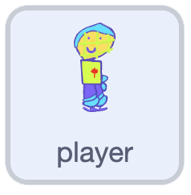
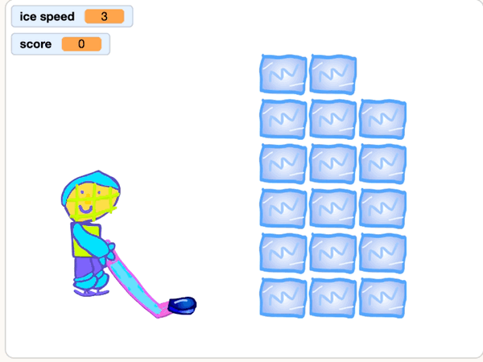

## Look surprised

Use sound and costumes to make the player animate.

{:width="80px"}

You're still working on the **player sprite**.

## Step 1

Add a `wait`{:class="block3control"} and change the `costume`{:class="block3looks"} to the surprised look.

```blocks3
when green flag clicked
wait until <touching (ice v)?>
stop [other scripts in sprite v]
+wait (0.1) seconds
+switch costume to (surprised v)
stop [all v]
```

## Step 2

Choose and add a `sound`{:class="block3sound"} that works for game over.

```blocks3
stop [other scripts in sprite v]
wait (0.1) seconds
switch costume to (surprised v)
+play sound (Alien Creak2 v) until done
stop [all v]
```

## Now run your code

Click the **Green Flag** and let the **ice** reach the **player**. Check that the **player** looks surprised and a sound plays before the game stops.

{:width="450px"}

