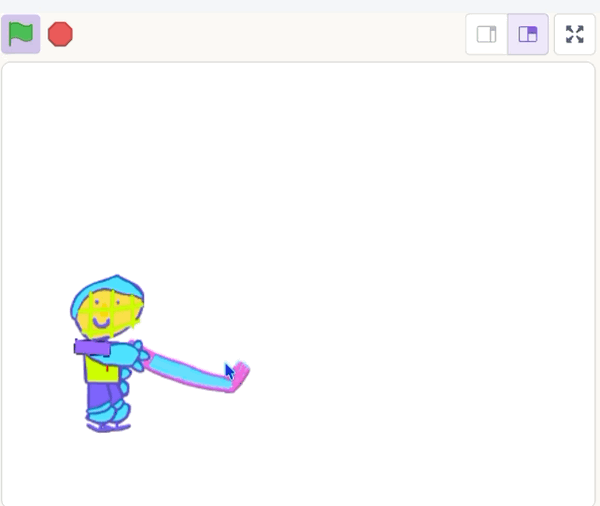

## Place the puck

Position the puck before you shoot.

{:width="150px"}

## Step 1

Click on the **puck sprite**.

Add a `when I receive`{:class="block3events"} block set to `reset`{:class="block3events"}.

Then add a `repeat until`{:class="block3control"} loop with a `mouse down?`{:class="block3sensing"} block.

```blocks3
when I receive (reset v)
repeat until <mouse down?>
end
```

## Step 2

Add a `go to`{:class="block3motion"} stick block and a `point towards`{:class="block3motion"} the mouse block inside the loop.

```blocks3
when I receive (reset v)
repeat until <mouse down?>
+ go to (stick v)
+ point towards (mouse-pointer v)
end
```

**Test:** the puck follows the stick and points towards the mouse, but it is in the wrong place.

## Step 3

`Move`{:class="block3motion"} the puck `130` steps to position it on the blade of the stick.

```blocks3
when I receive (reset v)
repeat until <mouse down?>
go to (stick v)
point towards (mouse-pointer v)
+ move (130) steps
end
```

## Step 4

Stop the puck from turning by adding a `set rotation style`{:class="block3motion"} block set to `don't rotate`.

Then add a `set drag mode`{:class="block3sensing"} block set to `not draggable`.

```blocks3
when I receive (reset v)
+ set rotation style [don't rotate v]
+ set drag mode [not draggable v]
repeat until <mouse down?>
go to (stick v)
point towards (mouse-pointer v)
move (130) steps
end
```

## Now run your code

Click the **Green Flag** and move the mouse.
Check that the puck moves with the stick as it turns.

{:width="450px"}
