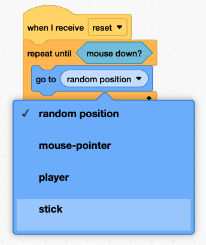

## Place the puck

Position the puck before you shoot.

{:width="150px"}

You're still working on the **puck sprite**.

## Step 1

Add a `when I receive`{:class="block3events"} block.

Then add a `repeat until`{:class="block3control"} loop with a `mouse down?`{:class="block3sensing"} block.

```blocks3
when I receive [reset v]
repeat until <mouse down?>
end
```

## Step 2

Add a `go to`{:class="block3motion"} stick block and a `point towards`{:class="block3motion"} the mouse block inside the loop.

```blocks3
when I receive [reset v]
repeat until <mouse down?>
+ go to (stick v)
+ point towards (mouse-pointer v)
end
```

> [!TIP]
> **stick** only appears in the `go to`{:class="block3motion"} drop-down once you click it open.

{:width="250px"}

## Now run your code

Click the **Green Flag** and move the mouse.
Check that the puck follows the stick, but it is in the wrong place.

{:width="450px"}
