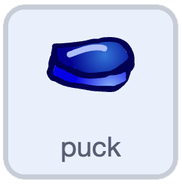
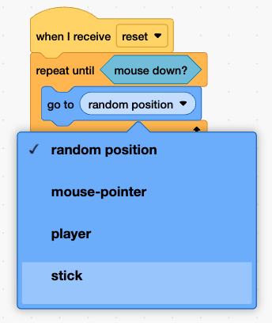
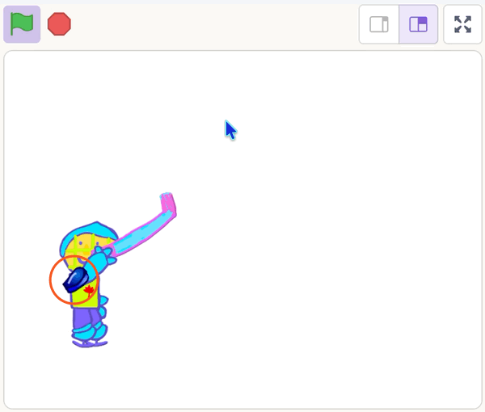

## Place the puck

Make the puck follow the stick.

{:width="80px"}

You're still working on the **puck sprite**.

## Step 1

Add a `when I receive`{:class="block3events"} block and choose `reset`{:class="block3events"} from the drop-down.

Then add a `repeat until`{:class="block3control"} loop with a `mouse down?`{:class="block3sensing"} block.

```blocks3
when I receive [reset v]
repeat until <mouse down?>
end
```

## Step 2

Add a `go to`{:class="block3motion"} **stick** block and a `point towards`{:class="block3motion"} the mouse block inside the loop.

```blocks3
when I receive [reset v]
repeat until <mouse down?>
+ go to (stick v)
+ point towards (mouse-pointer v)
end
```

> [!TIP]
>
> Use the drop-down to select **stick**.
>
> {:width="250px"}

## Now run your code

Click the **Green Flag** and check that the **puck** follows the **stick**.
You can move it to the blade in the next step.

{:width="450px"}
