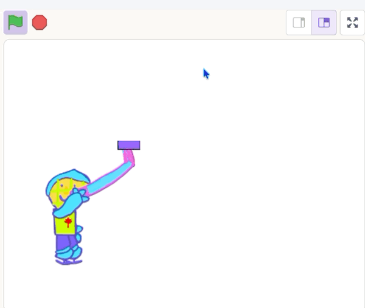

## Move the puck

Move the puck to the end of the blade.

{:width="150px"}

You're still working on the **puck sprite**.

## Step 1

`Move`{:class="block3motion"} the puck `130` steps to position it on the blade of the stick.

```blocks3
when I receive [reset v]
repeat until <mouse down?>
go to (stick v)
point towards (mouse-pointer v)
+ move (130) steps
end
```

## Step 2

Stop the puck from turning by adding a `set rotation style`{:class="block3motion"} block set to `don't rotate`{:class="block3motion"}.

Then add a `set drag mode`{:class="block3sensing"} block set to `not draggable`{:class="block3sensing"}.

```blocks3
when I receive [reset v]
+ set rotation style [don't rotate v]
+ set drag mode [not draggable v]
repeat until <mouse down?>
go to (stick v)
point towards (mouse-pointer v)
move (130) steps
end
```

## Now run your code

Click the **Green Flag** and move the mouse.
Check that the puck sits on the blade of the stick and moves with it as it turns.

{:width="450px"}
