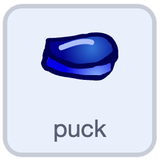
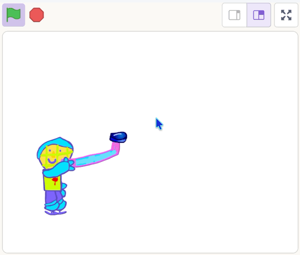

## Move the puck

Move the puck to the end of the blade.

{:width="150px"}

You're still working on the **puck sprite**.

## Step 1

`Move`{:class="block3motion"} the puck `130` steps to position it on the blade of the stick.

```blocks3
when I receive [reset v]
repeat until <mouse down?>
go to (stick v)
point towards (mouse-pointer v)
+ move (130) steps
end
```

## Step 2

Set the `rotation style` to 'don't rotate' so that it stops turning.

Then make it 'not draggable' with a `set drag mode` block.

```blocks3
when I receive [reset v]
+ set rotation style [don't rotate v]
+ set drag mode [not draggable v]
repeat until <mouse down?>
go to (stick v)
point towards (mouse-pointer v)
move (130) steps
end
```

## Now run your code

Click the **Green Flag** and check that the puck sits on the blade of the stick.

{:width="450px"}
