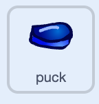

## Fire the puck

Send the puck flying when the mouse is released.



You're still working on the **puck sprite**.

## Step 1

Add a `wait until`{:class="block3control"} block with a `not`{:class="block3operators"} block and a `mouse down?`{:class="block3sensing"} block.

```blocks3
when green flag clicked
repeat until <mouse down?>
go to (stick v)
point towards (mouse-pointer v)
move (130) steps
end
+wait until <not <mouse down?>>
```

## Step 2

Add a `forever`{:class="block3control"} loop with a `move steps`{:class="block3motion"} block inside.

```blocks3
when green flag clicked
repeat until <mouse down?>
go to (stick v)
point towards (mouse-pointer v)
move (130) steps
end
wait until <not <mouse down?>>
+forever
move (12) steps
end
```

## Now run your code

Click the **Green Flag**, aim, then click and release the mouse.
Check that the puck flies off in the direction you aimed.
