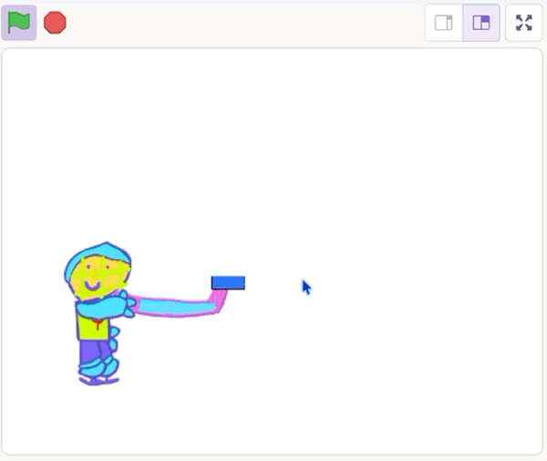

## Shoot the puck

Send the puck flying when the mouse is released.

{:width="150px"}

You're still working on the **puck sprite**.

## Step 1

Add a `wait until`{:class="block3control"} block with a `not`{:class="block3operators"} block and a `mouse down?`{:class="block3sensing"} block.

This makes the puck wait until the mouse is released.

```blocks3
when I receive [reset v]
set rotation style [don't rotate v]
set drag mode [not draggable v]
repeat until <mouse down?>
go to (stick v)
point towards (mouse-pointer v)
move (130) steps
end
+wait until <not <mouse down?>>
```

## Step 2

Add a `forever`{:class="block3control"} loop with a `move steps`{:class="block3motion"} block inside.


```blocks3
wait until <not <mouse down?>>
+forever
move (12) steps
end
```

## Step 3

Add an `if on edge, bounce`{:class="block3motion"} block inside the `forever`{:class="block3control"} loop.

```blocks3
wait until <not <mouse down?>>
forever
move (12) steps
+if on edge, bounce
end
```

## Now run your code

Click the **Green Flag**, move, then click. Check that the puck flies off in the direction you aimed at.

> [!TIP]
>
> Experiment with different numbers in the `move (12) steps`{:class="block3motion"} block to make the puck move faster or slower.

{:width="450px"}
 