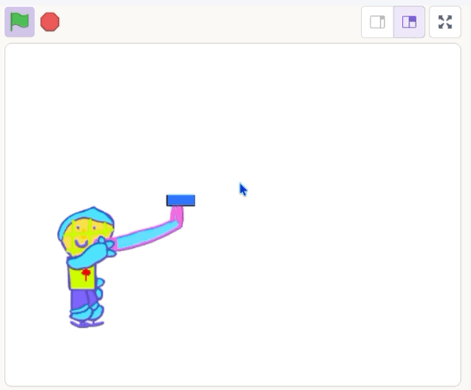

## Reset the shot

Send the puck back to the blade after each shot.


You're still working on the **puck sprite**.

## Step 1

Add a `broadcast`{:class="block3events"} block under the `hide`{:class="block3looks"} block.

```blocks3
forever
if <(timer) < (1)> then
move (12) steps
if on edge, bounce
else
hide
+broadcast (reset v)
end
end
```

Click the drop-down and choose `reset`.

## Step 2

Add a `when I receive`{:class="block3events"} block set to `reset` to an empty part of the code area, and add a `show`{:class="block3looks"} block under it.

```blocks3
when I receive (reset v)
show
```

## Step 3

Drag the blocks from under `set rotation style`{:class="block3motion"} to the `when I receive`{:class="block3events"} block.

```blocks3
when I receive (reset v)
show
+repeat until <mouse down?>
go to (stick v)
point towards (mouse-pointer v)
move (130) steps
end
+wait until <not <mouse down?>>
+reset timer
+forever
if <(timer) < (1)> then
move (12) steps
if on edge, bounce
else
hide
broadcast (reset v)
end
end
```

{:width="450px"}

## Now run your code

Click the **Green Flag**. Shoot the puck and check that it comes back to the blade for another shot.

{:width="450px"}
