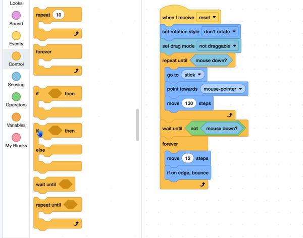

## Stop the puck

Stop the puck one second after it is shot.

{:width="150px"}

You're still working on the **puck sprite**.

## Step 1

Add an empty `if else`{:class="block3control"} block inside the loop, then drag the `move`{:class="block3motion"} and `if on edge`{:class="block3motion"} blocks inside the `if`{:class="block3control"} part.

{:width="450px"}

## Step 2

Add a `less than`{:class="block3operators"} block and a `timer`{:class="block3sensing"} block to the `if`{:class="block3control"}.

Type `1` into the second box.

```blocks3
wait until <not <mouse down?>>
forever
+if <(timer) < (1)> then
move (12) steps
if on edge, bounce
else
end
end
```

## Step 3

Add a `reset timer`{:class="block3sensing"} block before the `forever`{:class="block3control"} loop.

```blocks3
wait until <not <mouse down?>>
+reset timer
forever
if <(timer) < (1)> then
move (12) steps
if on edge, bounce
else
end
end
```

## Now run your code

Click the **Green Flag** and shoot the puck.
Check that the puck stops one second after it is shot.

> [!TIP]
>
> Change the number next to `timer`{:class="block3sensing"} to make the puck stop sooner or later.

{:width="450px"}
