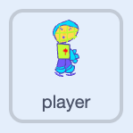
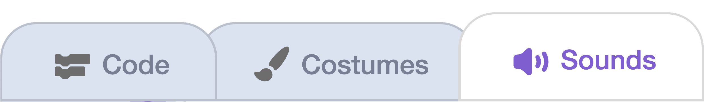
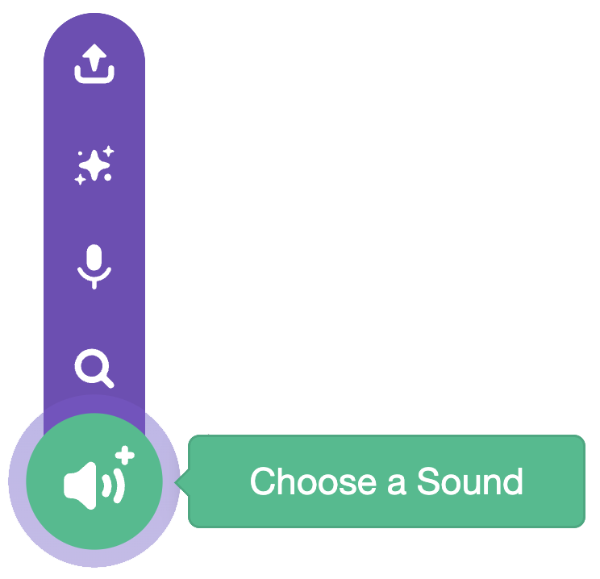

## Add swing sound

Play a sound when the player swings.

{:width="150px"}

## Step 1

Click on the **player sprite**.

Open the **Sounds** tab.

{:width="450px"}

## Step 2

Click **Choose a Sound** and pick one that will work for a swing from the library.

{:width="250px"}

## Step 3

Back in the **Code** tab, add a `start sound`{:class="block3sound"} block and choose your sound.

```blocks3
wait until <not <mouse down?>>
+start sound (Tennis Hit v)
switch costume to (costume 2 v)
wait (0.3) seconds
switch costume to (costume 1 v)
```

## Now run your code

Click the **Green Flag**. Shoot the puck and check that your sound plays.

{:width="450px"}
