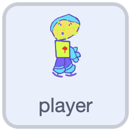
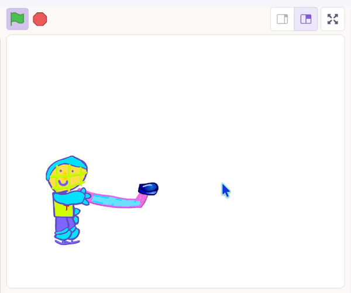

## Animate player

Make the player swing their arm when the puck is shot.

{:width="80px"}

Click on the **player sprite**.

## Step 1

First set the starting costume.
Add a `repeat until`{:class="block3control"} loop and insert `mouse down`{:class="block3sensing"}. Add a `switch costume`{:class="block3looks"} to `stand`{:class="block3looks"}.

```blocks3
when I receive [reset v]
go to x: (-159) y: (-58)
set drag mode [not draggable v]
+ repeat until <mouse down?>
+ switch costume to (stand v)
end
```

## Step 2

Add a `wait until`{:class="block3control"} block with `not mouse down?`{:class="block3sensing"} after the loop.

```blocks3
when I receive [reset v]
go to x: (-159) y: (-58)
set drag mode [not draggable v]
repeat until <mouse down?>
switch costume to (stand v)
end
+wait until <not <mouse down?>>
```

## Step 3

Then animate by switching to `shoot`{:class="block3looks"}, waiting, and switching back to `stand`{:class="block3looks"}.

```blocks3
wait until <not <mouse down?>>
+switch costume to (shoot v)
+wait (0.3) seconds
+switch costume to (stand v)
```

## Now run your code

Click the **Green Flag**. Shoot the **puck** and check that the **player** animates.

{:width="450px"}
