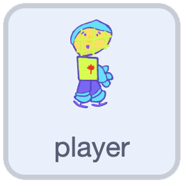
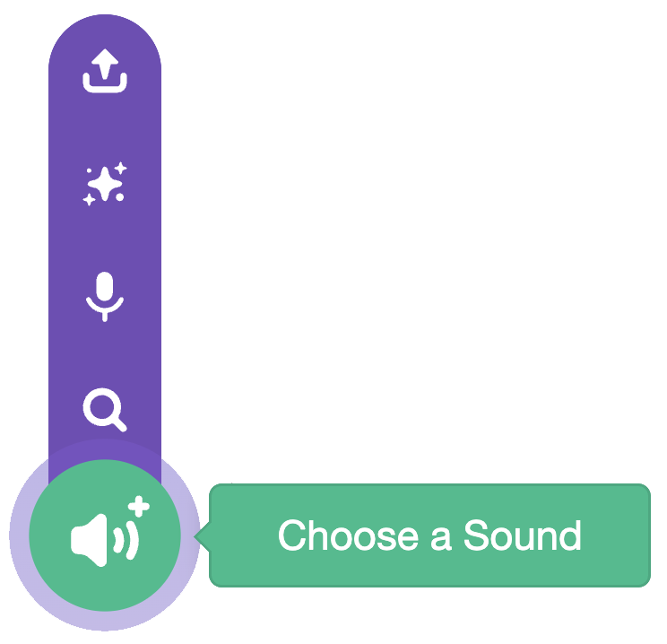
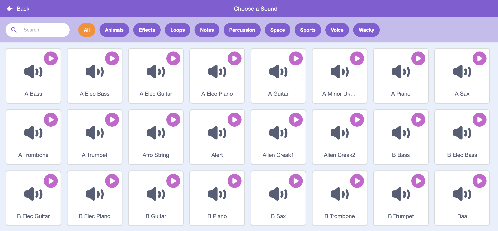

## Add shoot sound

Play a sound when the player shoots the puck.

{:width="80px"}

You're still working on the **player sprite**.

## Step 1

Open the **Sounds** tab.

{:width="450px"}

## Step 2

Click **Choose a Sound**.

{:width="250px"}

## Step 3

Pick a sound that will work for a swing from the library.

{:width="450px"}

## Step 4

In the **Code** tab, add a `start sound`{:class="block3sound"} block and choose your sound.

```blocks3
wait until <not <mouse down?>>
+start sound (Tennis Hit v)
switch costume to (shoot v)
wait (0.3) seconds
switch costume to (stand v)
```

## Now run your code

Click the **Green Flag**. Shoot the **puck** and check that your sound plays.
