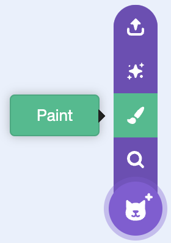
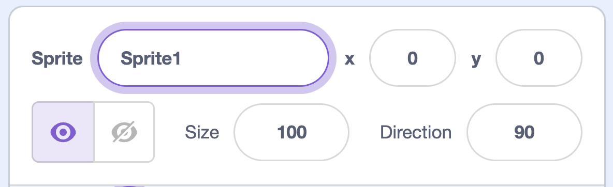

## Create the ice

Make a block of ice for the puck to pop.

## Step 1

Hover over the **Choose a Sprite** button and click **Paint**.

{:width="250px"}

## Step 2

Draw a block of ice and position it in the centre of paint window.

## Step 3

Name the sprite `ice` in the **Sprite** name box.

{:width="250px"}

{:width="450px"}
